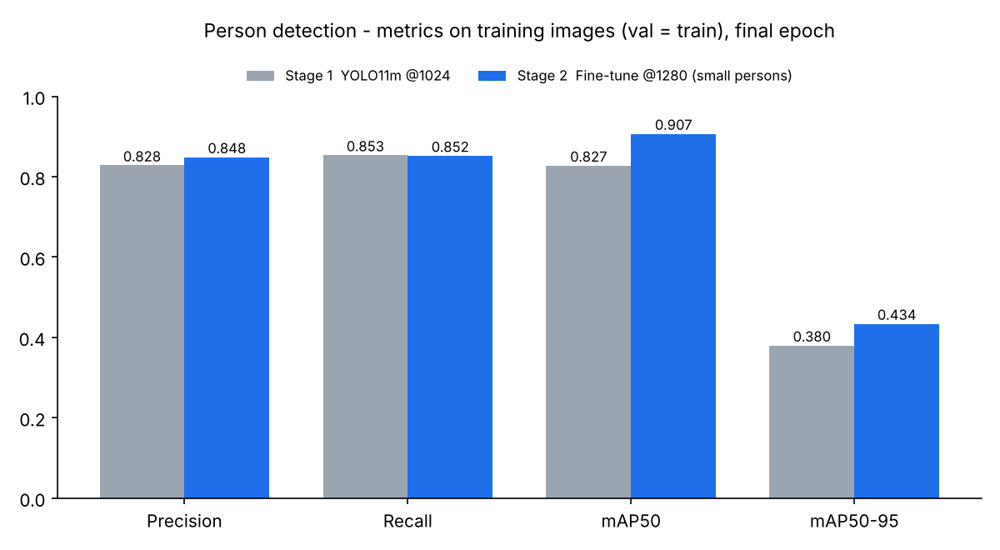
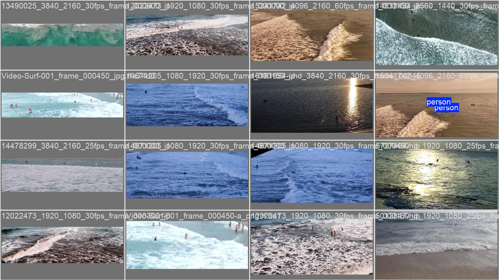
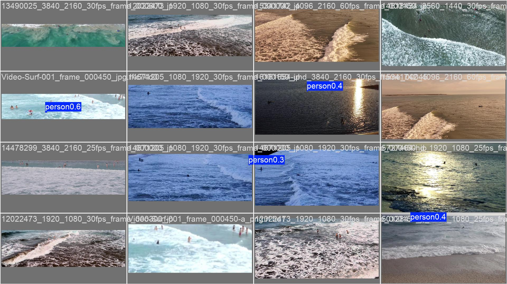
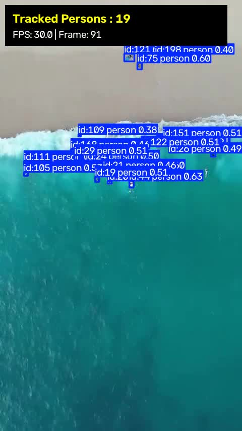
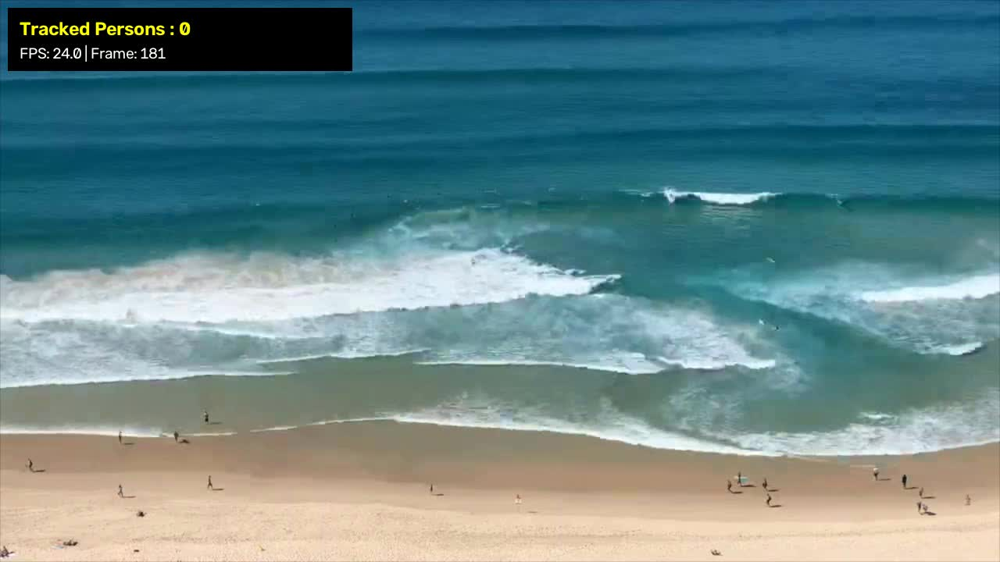

# 이안류 긴급 알리미 – 사람(입수자) 탐지 모델

해안 CCTV 영상에서 바다에 들어간 사람을 찾아내는 **YOLO11m 사람 탐지 모델**의 데이터 정제·학습·파인튜닝 코드와 결과입니다.

팀 프로젝트 **[이안류 긴급 알리미 (팀 비버즈)](https://github.com/gonggong77/team_beavers)** 에서 제가 맡은 부분만 따로 정리한 저장소입니다.
관제 콘솔(Streamlit), 위험 등급 판정, FCM 푸시 알림, 안드로이드 앱 등 서비스 전체 코드는 팀 레포에 있습니다.

> DAIVE 1기 (동국대학교 AI 머신러닝 부트캠프) · 팀 4명 · 10일 · 2026.09

<br>

## 한눈에 보기

| | 1차 학습 | 2차 파인튜닝 |
|---|---|---|
| 데이터 | Roboflow *search and rescue* 정제본 1,028장 (사람 878 · 배경 150) | CCTV 크기의 **작은 사람** 위주로 다시 구성한 데이터셋 |
| 입력 해상도 | 1024 | **1280** |
| Precision | 0.828 | **0.848** |
| Recall | 0.853 | 0.852 |
| **mAP50** | 0.827 | **0.907** |
| mAP50-95 | 0.380 | **0.434** |



> ⚠️ **주의: 위 지표는 학습 데이터 기준 점수입니다.**
> 두 단계 모두 별도 검증 폴더 없이 `val` 경로를 학습 이미지와 같게 지정해 학습했습니다(아래 *한계와 다음 단계* 참고).
> 따라서 처음 보는 데이터에서의 일반화 성능이 아니라, 학습 데이터에 얼마나 잘 맞췄는지를 보여 주는 값입니다.

<br>

## 문제와 해결 과정

### 1. 데이터 정제
CCTV 연속 프레임과 가공된 이미지가 섞여 있어, 학습 전에 아래 과정을 거쳤습니다.

| 단계 | 이미지 수 |
|---|---|
| 원본 | 4,955장 |
| 유사 프레임 제거 (3,670장 격리) | 1,285장 (사람 878 · 배경 407) |
| 배경 과다분 제거 (257장 격리, 사람:배경 ≈ 8.5:1.5) | **1,028장 (사람 878 · 배경 150)** |

검정 박스 이미지 검사도 실행했지만 이 데이터셋에서는 해당 이미지가 없었습니다(0장).

| 스크립트 | 하는 일 |
|---|---|
| `src/preprocess_remove_black_box.py` | 화면 일부가 검정 박스로 가려진 이미지 격리 (픽셀값 5 이하 영역이 30×30 이상, 사각형 비율 85% 이상) |
| `src/preprocess_remove_duplicates.py` | 거의 같은 연속 프레임 격리 (64×64 축소 후 직전 기준 프레임과의 MSE < 700) |

지운 파일은 삭제하지 않고 `*_backup/` 폴더로 옮겨 다시 확인할 수 있게 했습니다.

### 2. 1차 학습 – 검증 점수는 높았지만 실제 영상에서는 놓침
- YOLO11m, 1024px, 배치 8, 40 epoch, 모자이크 증강 끔
- 학습 데이터 기준 **Recall 0.853, mAP50 0.827**
- 그런데 실제 해안 CCTV 영상에 적용하자 **사람을 거의 잡지 못했습니다.**
  학습 데이터의 사람은 비교적 크게 찍혀 있었지만 실제 CCTV 속 사람은 몇 픽셀 크기의 점이었고,
  점수 자체도 학습 이미지로 평가한 값이라 실제 성능보다 높게 나왔기 때문입니다.

> 점수가 높아도 평가 데이터와 실제로 쓰일 환경이 다르면 소용이 없다는 것을 확인한 단계입니다.

### 3. 2차 파인튜닝 – 작은 사람에 맞춘 데이터와 해상도
- **데이터:** CCTV에 나오는 사람 크기만큼 작은 바운딩 박스만 골라 2차 데이터셋 구성
- **해상도:** 1024 → 1280 으로 올려 작은 객체가 사라지지 않게 함
- **증강:** mosaic·mixup·erasing 을 끄고 scale 을 줄여 작은 사람이 더 작아지거나 가려지지 않게 함
- **손실 가중치:** cls 1.0 → 1.5 로 올려 흐릿한 객체에도 반응하도록 함
- **학습률:** 1차 가중치를 망가뜨리지 않도록 lr0 0.0008 로 낮춤

학습 데이터 기준 **mAP50 0.827 → 0.907**, Precision 0.828 → 0.848 로 올랐고 Recall 은 비슷하게 유지되었습니다.

### 4. 서비스 적용
팀 서비스에서는 이 모델에 **SAHI 타일 슬라이싱(768×768, overlap 18%)** 을 붙여, 넓은 CCTV 화면을 잘게 나눠 추론하는 방식으로 먼 거리의 작은 사람을 검출합니다.
(추론 파이프라인 코드: 팀 레포 `rip_service_console/core/pipeline.py`)

<br>

## 결과 이미지

| 2차 파인튜닝 – 정답 라벨 | 2차 파인튜닝 – 모델 예측 |
|---|---|
|  |  |

| 영상 추론 테스트 (추적) | 광역 CCTV 화면 테스트 |
|---|---|
|  |  |

광역 CCTV 화면처럼 사람이 매우 작게 찍히는 경우에는 모델 단독 추론만으로 놓치는 경우가 많아, 서비스에서는 SAHI 를 함께 사용했습니다.

학습 곡선, PR 곡선, 혼동행렬 등 전체 결과는 `results/` 폴더에 있습니다.

<br>

## 폴더 구조

```
├── src/
│   ├── preprocess_remove_black_box.py    # 검정 박스 이미지 제거
│   ├── preprocess_remove_duplicates.py   # 유사 프레임 제거
│   ├── train_stage1_yolo11m.py           # 1차 학습
│   └── finetune_stage2_small_person.py   # 2차 파인튜닝
├── inference/
│   └── track_person_video.py             # 영상 추적 추론 테스트
├── results/
│   ├── stage1_yolo11m_1024/              # 1차 학습 결과 (args.yaml, results.csv, 그래프)
│   └── stage2_finetune_1280/             # 2차 파인튜닝 결과
└── assets/                               # README 이미지
```

`results/*/args.yaml` 은 실제 학습 때 Ultralytics 가 기록한 설정 파일입니다. (로컬 절대경로만 상대경로로 정리)

<br>

## 실행 방법

```bash
pip install -r requirements.txt

# 1) 데이터 정제 (person_data/images, person_data/labels 기준)
python src/preprocess_remove_black_box.py
python src/preprocess_remove_duplicates.py

# 2) 1차 학습 → 3) 2차 파인튜닝
python src/train_stage1_yolo11m.py
python src/finetune_stage2_small_person.py

# 4) 영상 추론 테스트
python inference/track_person_video.py --weights best.pt --source test.mp4
```

- 데이터셋과 학습된 가중치(`*.pt`)는 용량 문제로 저장소에 포함하지 않았습니다.
- 학습 환경: Windows, NVIDIA RTX 4080 SUPER (16GB), Ultralytics YOLO11

<br>

## 한계와 다음 단계

- **검증 데이터 분리 미흡:** 두 단계 모두 `data.yaml` 의 `val` 을 `train` 과 같은 폴더로 지정했습니다. 학습에 쓰지 않은 데이터로 평가하지 않았기 때문에 위 점수는 실제 성능보다 높게 나왔을 가능성이 큽니다.
- **다음에 할 일:** 카메라·촬영 시간 단위로 train / val / test 를 분리하고, 실제 해안 CCTV 프레임으로 만든 별도 테스트셋에서 Recall 을 측정하겠습니다.
- 실제 서비스에서는 이 한계를 보완하기 위해 SAHI 타일 추론을 함께 사용했습니다.

<br>

## 배운 점

- **평가 데이터가 무엇인지가 점수보다 중요하다.** 1차 모델은 Recall 0.85 였지만 실제 CCTV 영상에서는 사람을 거의 찾지 못했습니다. 돌아보니 점수는 학습 이미지로 낸 값이었고, 학습 데이터 속 사람 크기도 실제 화면과 달랐습니다. 이후로는 실제로 쓰일 화면 기준으로 데이터를 다시 만들었고, 다음 프로젝트에서는 학습과 분리된 테스트셋부터 만들고 시작하려 합니다.
- **작은 객체 탐지는 데이터·해상도·증강을 함께 바꿔야 한다.** 모델 크기를 키우기보다, 목표 객체 크기에 맞춘 데이터 정제와 고해상도 학습, 객체를 작게 만드는 증강을 끄는 것이 효과적이었습니다.

<br>

## 팀 프로젝트

- 팀 레포: https://github.com/gonggong77/team_beavers
- 담당: 사람 탐지 모델 (데이터 정제, YOLO11m 학습·파인튜닝)
